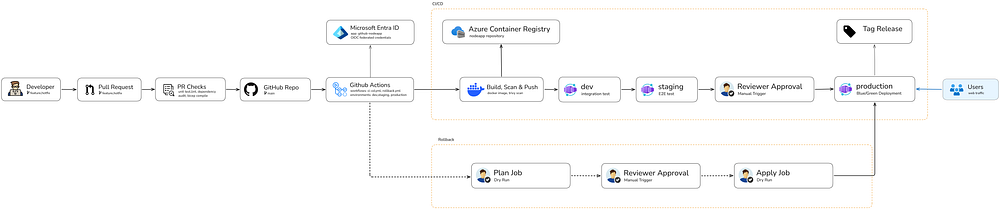

# Github Actions Multi Environment CI/CD Pipeline on Azure Container Apps

A release pipeline for a small Node.js service. Each commit builds one container image, which is scanned, pushed, and promoted by digest through `dev`, `staging`, and `production`. Production releases switch traffic between two labeled revisions, and rollback is a traffic change. No passwords or client secrets are stored anywhere.



## Documentation

- [Blog Post](https://medium.com/@yushan.jayaweera/building-a-multi-environment-ci-cd-pipeline-on-azure-container-apps-fd8e58458b99?sharedUserId=yushan.jayaweera)
- [`docs/architecture.md`](docs/architecture.md): architecture breakdown.
- [`docs/setup.md`](docs/setup.md): step by step build guide.

## Pipeline

- **Pull request:** tests, lint, dependency audit, and Bicep compilation. No Azure access.
- **Merge to `main`:** build, Trivy scan, push, and record the image digest.
- **Dev:** automatic deploy, then an integration test that checks the running version matches the commit.
- **Staging:** automatic deploy, then end-to-end tests.
- **Production:** waits for a reviewer, then a blue/green release with a verified switch and a five-minute watch.
- **Tag:** `prod-<sha7>` after a successful production release.

## Rollback

Rollback is manual. Start **Roll back production** from the Actions tab.

**Plan (no approval).** The plan job reads production and prints the result to the run summary. It checks that:

- exactly one labeled revision holds 100% of traffic,
- the standby label names a revision at 0%,
- no release is running, queued, or waiting for approval, and
- the standby revision passes its own health check.

A dry run stops after the plan.

**Apply (reviewer approval).** The apply job waits for the `production` reviewer. Before changing anything, it checks for a release again and reads the traffic table. If the live or standby revision differs from the plan, it stops with `not-applied`. Otherwise it moves traffic by label, then reads the table back to verify the switch.

Rollback restores service. The fix is a normal commit that goes through the normal pipeline.

## Identity

- **Deploys:** GitHub Actions gets a short-lived OpenID Connect token for each job. The deploy identity is the Entra app registration `github-nodeapp`. No client secret exists.
- **Image pulls:** the container apps use the managed identity `id-nodeapp-pull`, which holds AcrPull only. The registry's admin user is disabled.

Scope of the deploy identity: Contributor on each environment resource group, AcrPush on the registry, and Managed Identity Operator on the pull identity. Contributor is broader than necessary, which is listed under limits.

## Run locally

Requires Node.js 24 and Docker.

```bash
npm ci
npm start                 # http://localhost:3000
npm test
npm run lint

docker build -t nodeapp:local .
docker run --rm -p 3000:3000 -e ENVIRONMENT=local -e APP_VERSION=local nodeapp:local
```

Check the endpoints with `curl http://localhost:3000/health` and `curl http://localhost:3000/api/status`.

## Repository layout

```
.github/
  dependabot.yml          weekly updates for actions, npm, and the base image
  workflows/ci-cd.yml     pull request checks and the release pipeline
  workflows/rollback.yml  manual rollback with a dry run
azure/
  shared/                 pull identity, created once
  env/                    Container Apps environment
  app/                    the container app, used for every environment
  params/                 one parameter file per environment
docs/                     documentation on architecture and setup
src/                      app.js and the status page
tests/                    unit, integration, and end-to-end tests
Dockerfile                multi staged dockerfile
```

## Observability

- Health probes on each replica. The platform restarts a replica that fails its probe.
- A five-minute release watch after each production switch, which reverts on failure.
- A restart alert on production, emailed through `ag-nodeapp-prod`. A restart inside a release window is expected.
- GitHub deployment records for each environment, with the digest, revision, and URL.
- `/api/status` reports the commit that is running.

There are no request logs and no error-rate alert.

## Limits

- **Single region.** The app is stateless, so the failure this design protects against is a bad release, not a regional outage.
- **No database.** Blue/green doesn't handle incompatible schema changes.
- **No automatic failover.** After the release watch, a failure is found by the restart alert or a person, then fixed with a manual rollback.
- **Solo approvals.** On a personal repository, the reviewer is also the author.
- **Broad deploy permissions.** Contributor on each environment group.
- **Two revisions.** Rollback reaches one release back.

The [architecture](docs/architecture.md) document covers each limit in more detail.

