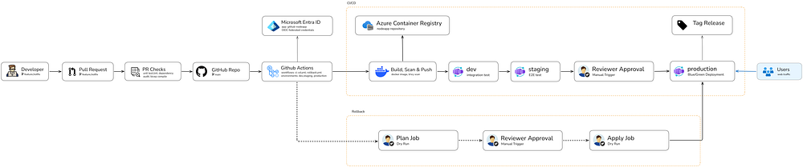

# Architecture


**Repository:** `dewnuwan7/azure-multi-env-cicd-pipeline`

Companion documents: `setup.md` 

---

## 1. Scope

In scope: build, test, scan, promotion across dev, staging, and production, blue/green releases, rollback, deployment records, and a restart alert on production. The project keeps no request logs (see D12).

Out of scope: databases, multi-region failover, Kubernetes, custom application features, and a full observability platform. Each out-of-scope item is listed in section 14 with the reason.

---

## 2. Decisions

Each decision lists what was chosen, what was rejected, and why. The reasoning matters more than the choice, because it's what gets discussed.

| # | Area | Chosen | Rejected | Why |
|---|---|---|---|---|
| Branching | Trunk-based: `main` plus short feature branches | GitFlow; release-branch promotion | One long-lived branch, one artifact per commit. Release branches add promotion pull requests and drift without adding control for a solo maintainer |
| Compute | Azure Container Apps | Container Instances; AKS | Container Apps has HTTPS, revisions, traffic weights, and probes built in. ACI would need a router in front, and AKS adds cluster operations the project doesn't need |
| Routing | Container Apps traffic weights on labeled revisions | Front Door; Traffic Manager | No extra resource to build or pay for. Front Door's fixed cost was out of proportion to one small app |
| Artifact identity | Image digest (`@sha256:`) for every deployment | Mutable tags | A tag can be re-pushed. A digest can't change, so "same artifact everywhere" is enforced rather than assumed |
| Promotion | Build once on `main`, promote the same digest | Rebuild per environment | A rebuild could produce a different artifact, so staging would test something production never receives |
| Dev and staging gates | Automatic, after integration tests pass | Reviewer on staging | Staging sees every release that passed dev. Production remains the only human decision |
| Production gate | Required reviewer on `production` | Automatic production | A person decides what reaches users. Solo approval is a pause, not a second review (see section 11) |
| Production release | Blue/green with labels, checked on the new revision's own URL before traffic moves | In-place update | Users never receive a version that hasn't been checked. Rollback is a traffic change |
| Rollback target | The last version, identified by revision name and labeled into the other slot | Choosing by color alone | Colors describe roles. Revision names record what actually ran |
| Identity for pulls | User-assigned managed identity with AcrPull | Registry admin user; stored password | No secret exists to leak or rotate |
| Identity for deploys | Entra app registration with OIDC federated credentials | Client secret | GitHub presents a short-lived token per job. Each credential names one exact subject |
| Logging | No request logs in any environment. The platform's restart metric and the release records are the observability | Structured request logs with a workspace; full observability stack | Logs add a workspace, a retention decision, a daily cap, and alerts built on them. The project is about the release process, and those costs and moving parts would dilute it. The gap is stated in section 12 |
| Alerts | Restart count on production (platform metric) | Error-ratio alert on request logs | Without logs there is no error count to alert on. The restart alert is the one signal the platform gives without extra configuration |
| Region | `eastus` for all resources | `eastus` | Matches the environments that exist. The design is single-region by choice (section 14) |
| Names | Per-environment container app names: `nodeapp-dev`, `nodeapp-staging`, `nodeapp-prod` | One name `nodeapp` in every group | The Azure portal and CLI show which environment a resource belongs to at a glance |
| Deployment mechanism | Azure CLI `az containerapp update` for dev, staging, and production, with a commit-named revision | `azure/container-apps-deploy-action` | The CLI sets the revision suffix, keeps the registry identity and probes, and makes the state checks explicit. The action doesn't expose a revision suffix, so revision names were generated |
|  Action pinning | Pinned to commit SHAs, updated by Dependabot | Floating tags | A tag can be moved to different code. A commit SHA can't |

---

## 3. Naming

| Resource | Name | Notes |
|---|---|---|
| Resource groups | `rg-nodeapp-shared`, `rg-nodeapp-dev`, `rg-nodeapp-staging`, `rg-nodeapp-prod` | Region `eastus` |
| Registry | `thesudofiles` | Basic SKU, admin user disabled |
| Image repository | `thesudofiles.azurecr.io/nodeapp` | Deployed by digest |
| Pull identity | `id-nodeapp-pull` | AcrPull only |
| Deploy app registration | `github-nodeapp` | Federated credentials, no secret |
| Container Apps environments | `cae-nodeapp-dev`, `cae-nodeapp-staging`, `cae-nodeapp-prod` | No log destination in any environment |
| Container apps | `nodeapp-dev`, `nodeapp-staging`, `nodeapp-prod` | One per environment |
| Revisions | `nodeapp-<env>--<sha7>` | The suffix is the first seven characters of the commit |
| Production labels | `blue`, `green` | Roles, not identities |
| Action group | `ag-nodeapp-prod` | Email receiver |

The short SHA appears in revision names and release tags. It's a display identifier. The digest is the artifact identity.

---

## 4. System

```
                       Users (HTTPS, default address)
                                   │
                                   ▼
 ┌────────────────────── cae-nodeapp-prod (eastus) ──────────────────────┐
 │  nodeapp-prod                                                         │
 │    ingress ── traffic weights by label                                │
 │      blue  → revision nodeapp-prod--<sha>   (live, 100%)              │
 │      green → revision nodeapp-prod--<sha>   (standby, 0%)             │
 │    probes: GET /health                                                │
 └───────────────────────────────────────────────────────────────────────┘
                                   ▲
                 pulls by digest, using id-nodeapp-pull (AcrPull)
                                   │
 ┌──── rg-nodeapp-shared ────────────────────────────────────────────────┐
 │  thesudofiles (ACR, Basic)      id-nodeapp-pull                       │
 └───────────────────────────────────────────────────────────────────────┘

 GitHub Actions ──OIDC token per job──► Entra ID ──► github-nodeapp
      └── deploys to rg-nodeapp-dev / -staging / -prod (Contributor, per group)
```

Dev, staging, and production each run one container app. Dev and staging use single revision mode. Production uses multiple revision mode, for the blue/green labels. No environment sends logs anywhere.

---

## 5. Environments

| Environment | Container app | CPU | Memory | Replicas | Revision mode | Gate |
|---|---|---|---|---|---|---|
| Dev | `nodeapp-dev` | 0.25 | 0.5 Gi | 0 to 1 | Single | Automatic |
| Staging | `nodeapp-staging` | 0.5 | 1 Gi | 1 to 2 | Single | Automatic, after dev integration tests |
| Production | `nodeapp-prod` | 0.5 | 1 Gi | 1 to 3 | Multiple | Reviewer Approval |

Dev scales to zero to save cost, which means its first request after idle is slow. The integration test retries for that reason. Production keeps one replica so users never wait for a cold start.

---

## 6. Pipeline

### 6.1 Dependency graph



Each arrow is a `needs:` relationship. A failing job stops everything downstream. `Tag Release` needs `production deployment`, so a release tag can't exist for a production deploy that didn't succeed.

### 6.2 Jobs

| Job | Trigger | Gate | Azure access | Responsibility |
|---|---|---|---|---|
| `test` | Pull request and push | None | None | Unit tests, lint, dependency audit |
| `bicep` | Pull request and push | None | None | Compile every template |
| `build` | Push only | None | Push to registry | Build, scan for fixable critical and high vulnerabilities, push, record the digest |
| `deploy-dev` | Push | `dev` | Deploy to dev | Deploy by digest, smoke test, integration test against the exact commit, record deployment |
| `deploy-staging` | Push | `staging` | Deploy to staging | Deploy the same digest, end-to-end tests, record deployment |
| `deploy-prod` | Push | `production` (reviewer) | Deploy to production | Blue/green release, section 8 |
| `tag-release` | Push, after prod | None | Git only | Create `prod-<sha7>` tag |
| `rollback` (workflow) | Manual, started by a person | `production` (reviewer) for the apply job | Traffic and labels | Last-version rollback, section 9 |

### 6.3 Concurrency

Every deploy job and the rollback apply job use the group `nodeapp-release`, with `cancel-in-progress: false`. Only one release runs at a time.

GitHub keeps one pending run per group. When several merges queue behind a production approval, the newest pending run replaces the older ones. That's intended: the newest commit is what should reach production.

---

## 7. Artifact model

| Identifier | Form | Authority | Use |
|---|---|---|---|
| Image digest | `sha256:...` | **Authoritative** | Every deployment references it |
| Image tag | Full commit SHA | Alias, mutable | Human lookup in the registry |
| Revision name | `nodeapp-<env>--<sha7>` | Record of what ran | Rollback targets and the portal |
| Release tag | `prod-<sha7>` | Git record, protected by ruleset | Find the release in history |
| Deployment record | GitHub Deployments API | Metadata record | Environment, digest, revision, URL |
| Version field | Full commit SHA via `APP_VERSION` | Runtime proof | The status page and the integration test |

**note:** tags are mutable, so the same tag could resolve to a different image later. Deploying by digest makes "the artifact tested in staging is the artifact released" a property of the deployment, not a convention.

### 7.1 Deployment records

GitHub creates an environment record automatically for each job that declares an environment. The workflow also creates a deployment through the API that carries the digest, revision, and standby label. Each environment therefore shows two records on its page. The API record is the one with metadata. The automatic record links to the run.

---

## 8. Production release

### 8.1 Preconditions

Before any change, the release reads the traffic table and stops unless:

- Traffic sits on exactly one revision at 100%.
- That revision carries `blue` or `green` on the same row.

### 8.2 Steps

1. Read the live revision and label; choose the standby label (the other one).
2. Pin the live revision at 100%, so a new revision can't take traffic by default.
3. Create the new revision from the digest, with 0% traffic. Verify its weight is 0.
4. Move the standby label to the new revision. `label add` moves a label, so the old standby revision loses it.
5. Check the new revision through its own URL: `/health` and the end-to-end suite.
6. Switch traffic by label: live label to 0%, standby label to 100%.
7. Read the labels back. If the switch didn't verify, revert and fail.
8. Watch the public address for five minutes. On failure, revert and fail.
9. Keep only the two labeled revisions active: the live revision and the last version. Deactivate the rest.
10. Record the deployment, then create the release tag.

### 8.3 Label state transitions

| Situation | Release behavior |
|---|---|
| First release (only `blue` exists) | Standby is `green`. Green is created on the new revision |
| Normal release | Standby is whichever label isn't carrying traffic. Its previous revision loses the label |
| Traffic on neither label, or on two revisions | Release stops before changing anything |
| Switch read-back fails | Revert to the previous live label, then fail |
| Watch fails | Revert, then fail |
| Rollback | The standby label takes 100% and the live label takes 0%. Labels keep their roles; no color is assumed |

Labels describe roles, and the release never assumes a color means a particular version. It reads which revision is live before deciding anything.

---

## 9. Rollback

Rollback is a deliberate, manual action. A person starts it, reads the plan, and approves the switch. Labels describe roles, so the live label is whichever label carries 100% of traffic. Rollback never assumes a color.

### 9.1 Trigger

A person runs the rollback workflow from the Actions tab. A dry run prints the plan and requests no approval. A real run waits for the `production` reviewer before the apply job starts.

### 9.2 Plan (read-only)

1. Confirm exactly one labeled revision holds 100% of traffic. Abort otherwise.
2. Identify the live label, and the standby label as the other of blue and green. Abort on any other label.
3. Confirm the standby label names a revision and holds 0%.
4. Abort if a release is in progress, queued, or waiting for approval. That release's end state is what must be judged. If the run list can't be read, abort: an unknown state is not an idle one.
5. Health-check the standby revision on its own address. Abort if it fails, because a rollback onto a failing version doesn't help.

The plan job has no environment, so it needs no approval, and it can only read state.

### 9.3 Apply (gated)

1. Check again that no release has started or is waiting since the plan. Refuse if the run list can't be read.
2. Re-read the traffic table. If the live revision or the standby revision differs from the plan, stop with `not-applied`. Production changed after the decision.
3. Move traffic by label: the standby label to 100%, the live label to 0%.
4. Read the traffic table again and verify the switch. Fail if it doesn't match.
5. Report `rolled-back`.

The apply job runs in the `nodeapp-release` concurrency group, so it never overlaps a release.

### 9.4 Why labels are not swapped

After a rollback, the failed revision keeps its label at 0%, which is its standby role. The next release reads whichever label is live, so no relabeling is needed.

### 9.5 Retention

Only the two labeled revisions stay active: the live revision and the last version. The last version is the rollback target, so a rollback can reach one release back. Older versions need a redeploy from their commit.

### 9.6 What rollback does not do

- It doesn't fix the bug. `main` still holds the bad commit. The fix is a normal commit, released through the normal path.
- It doesn't see failures that `/health` doesn't show.
- It doesn't help when the last version is also failing. The plan aborts, and a person decides what to do next.

---

## 10. Configuration

### 10.1 Rules

- Image content is identical in every environment. Only explicitly managed runtime configuration differs.
- Runtime configuration lives in two places: Bicep parameter files for infrastructure shape, and GitHub Environment variables for values the pipeline passes at deploy time.
- Nothing sensitive lives in either place. The project has no secrets.
- A value that differs between environments is an environment variable, never a code branch.

### 10.2 What differs

| Setting | Dev | Staging | Production | Where |
|---|---|---|---|---|
| `ENVIRONMENT` | `dev` | `staging` | `prod` | Pipeline |
| `APP_VERSION` | Commit SHA | Commit SHA | Commit SHA | Pipeline |
| CPU, memory, replicas | Table 5 | Table 5 | Table 5 | Bicep parameters |

---

## 11. Identity and trust

### 11.1 Identities

| Identity | Type | Roles | Used by |
|---|---|---|---|
| `id-nodeapp-pull` | User-assigned managed identity | AcrPull on the registry | Container apps, to pull images |
| `github-nodeapp` | App registration with service principal | Contributor on three environment groups; AcrPush on the registry; Managed Identity Operator on `id-nodeapp-pull` | GitHub Actions |

### 11.2 Trust conditions

Each federated credential names one exact subject, in the form the GitHub OIDC token presents: `repo:<owner>@<owner-id>/<repo>@<repo-id>:<ref or environment>`. This form was verified from a real failed run, whose log showed the subject GitHub actually sent: `repo:OWNER@OWNER_ID/REPO@REPO_ID:...`. The simpler `repo:OWNER/REPO:...` form is what older documentation shows, and it does not match tokens from this repository. Check the subject in your own run log before creating or changing a credential, because the claim format is what Azure compares against.

| Credential | Subject (`OWNER/REPO` shown as `...`) | Trusts |
|---|---|---|
| `gh-main` | `...:ref:refs/heads/main` | Build and tag jobs on `main` |
| `gh-env-dev` | `...:environment:dev` | Dev deploy |
| `gh-env-staging` | `...:environment:staging` | Staging deploy |
| `gh-env-prod` | `...:environment:production` | Production deploy and manual rollback |

Pull requests have no credential, so a pull request can't reach Azure.

**GitHub environment protection is not an Azure security control.** Environment rules decide when GitHub runs a job. The federated credential decides which token Azure accepts. Both are needed, and only the Azure side enforces the subject.


---

## 12. Observability

### 12.1 What exists

- **Platform restart alert** on `nodeapp-prod`, sent by email through `ag-nodeapp-prod`. It is a coarse platform signal. A normal revision rollout can restart containers, so the alert is correlated with deployment records: a restart inside a release window is expected, and one outside it is the signal. A future improvement is to alert on repeated restarts (crash loops) outside any deployment.
- **Health probes** on each replica. The platform restarts a replica that fails its probe, and stops sending it requests while it isn't ready. This works within one revision. It does not move traffic between revisions.
- **The release watch.** Five minutes of health checks after each production switch. If a check fails, the release reverts its own traffic switch and fails.
- **Deployment records** in GitHub, with the digest, revision, and environment URL.
- **Version reporting.** `/api/status` returns the commit, and the integration test checks it.

### 12.2 The gap

After the release watch ends, nothing watches production. A failure that appears later, or one the health endpoint doesn't show, is found through the restart alert, a user report, or a person checking the app. Once a failure is found, the response is a manual rollback, and the `time to respond = time to notice + the time to act`. There are no request logs, so there is no error rate to alert on.

### 12.3 What industry practice adds

Production systems usually measure from outside the platform, from several locations, with synthetic tests that exercise real user paths, plus request-level telemetry for error rates and latency. Azure Monitor availability tests are the closest built-in equivalent. This project doesn't implement them, and section 14 lists them as the first production addition.

### 12.4 Deliberate gaps

- No request logs, no error-rate alerts, no dashboards, no tracing.
- No latency alert. The app has no latency target to measure against.

---

## 13. Security and supply chain

| Control | Where | Status |
|---|---|---|
| No stored secrets | Entire design | Enforced by design |
| Admin user disabled on the registry | Registry | Enforced |
| Image scanned before push | `build` job, Trivy, critical and high, fixable only | Enforced |
| Actions pinned to commit SHAs | All workflows | Required; Dependabot updates them |
| Dependency updates | Dependabot for actions, npm, Docker | Configured |
| Release tags protected | Tag ruleset on `prod-*` | Configured |
| Required checks before merge | `test` and `bicep` on `main` | Configured |
| Non-root container | Dockerfile `USER node` | Enforced |
| Production deploys need a reviewer | `production` environment | Enforced |

Not included: SBOM generation, build provenance attestations, and runtime threat detection.

---

## 14. Limits, deferred work, and reasons

| Item | Status | Reason |
|---|---|---|
| Separate deploy identity per environment, with custom roles | Deferred | Requires role design and extra federated credentials. Scope is documented in section 11.3 |
| Bicep drift detection, and `what-if` on pull requests | Deferred | Needs Azure access from pull request runs, which the design deliberately avoids |
| Multi-region, failover, and backups | Out of scope | The app is stateless and has no data. Single-region is a stated limit |
| Database and schema migrations | Out of scope | No database. Blue/green doesn't solve incompatible schema changes |
| Request logs, error alerts, dashboards, tracing | Out of scope | Scope is the release process. |
| Solo approvals | Accepted limitation | On a personal repository, the production gate pauses but doesn't add a second reviewer |


